# Práctica: Gestión Avanzada de Ramas y Resolución de Conflictos

---

## Preparación del entorno

### 1. Crear directorio y acceder
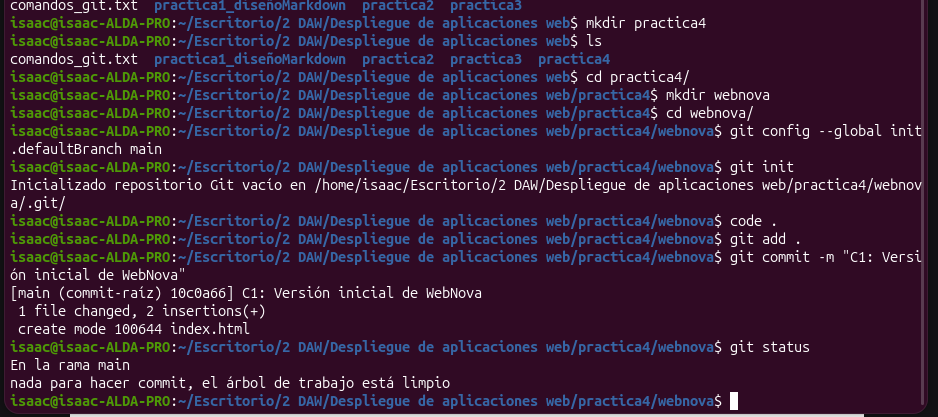

### 2. Crear `index.html`
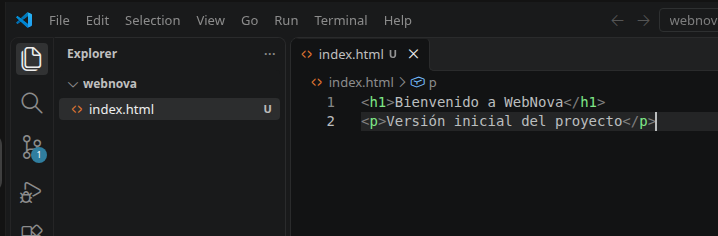

### 3. Añadir y confirmar
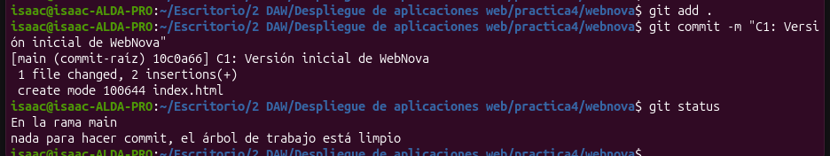

---

## Parte 1: Desarrollo en paralelo

### 1. Crear las tres ramas
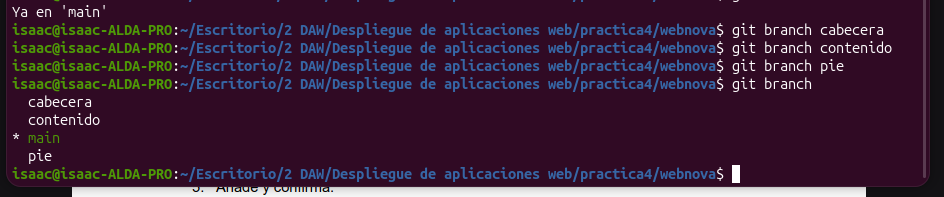
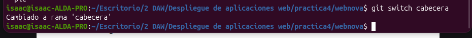

### 2. Rama `cabecera`
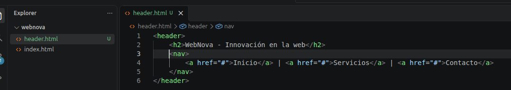
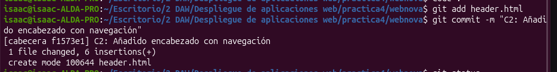

### 3. Rama `contenido`
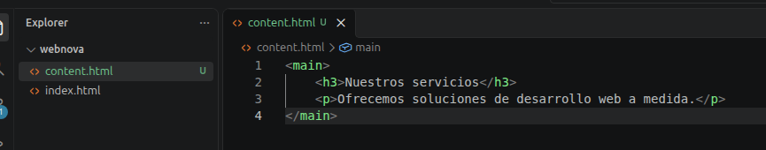
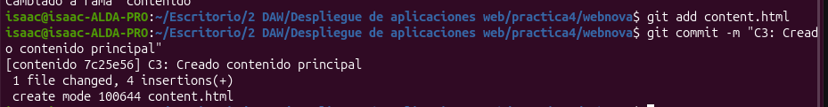

### 4. Rama `pie`
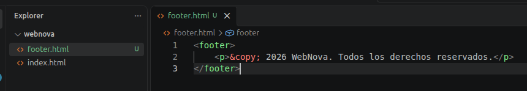
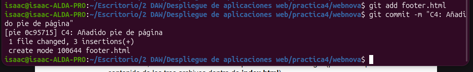

---

## Parte 2: Integración (fusiones sin conflicto)

### 1. Fusionar las ramas
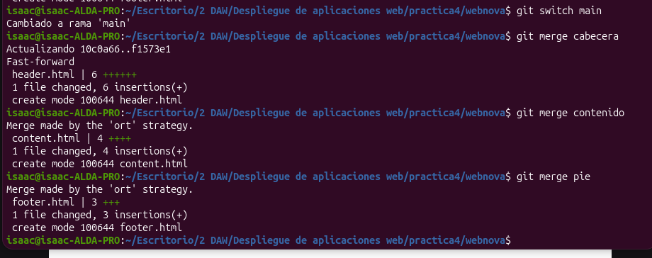

### 2. Unificar el código en `index.html`
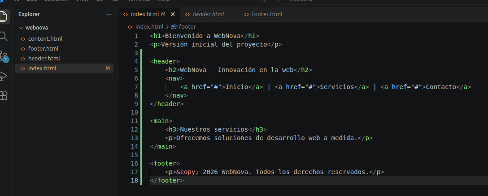

### 3. Commit de consolidación y eliminar las ramas de desarrollo
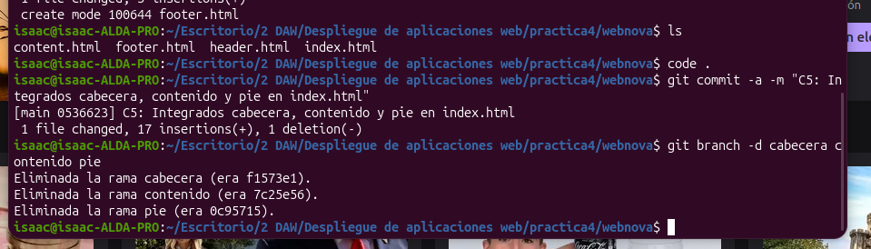

---

## Parte 3: Provocar y resolver un conflicto

### 1. Crear la rama `rediseño`
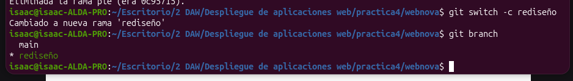

### 2. Modificar el `<h1>` y confirmar
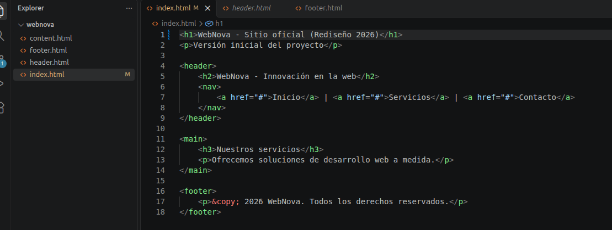
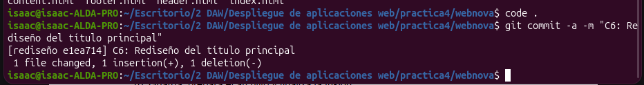

### 3. Modificar el `<h1>` otra vez en main y confirmar
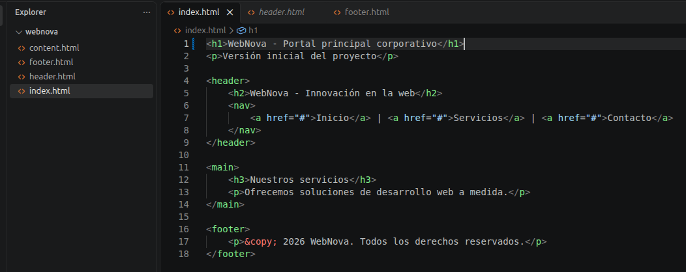
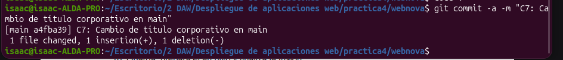

### 4. Fusionar (conflicto)
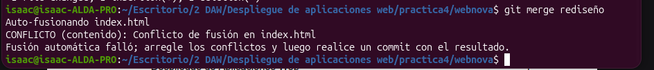

### 5. Archivo con las marcas de conflicto
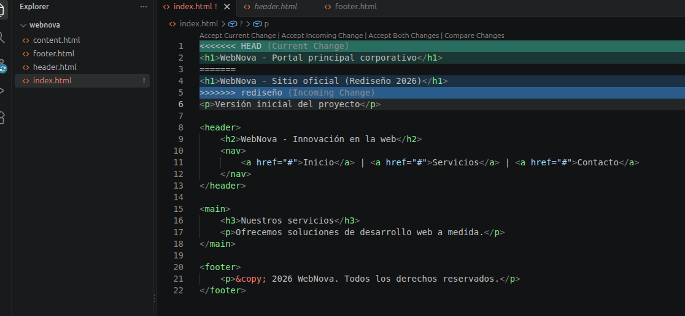

### 6. Arreglar
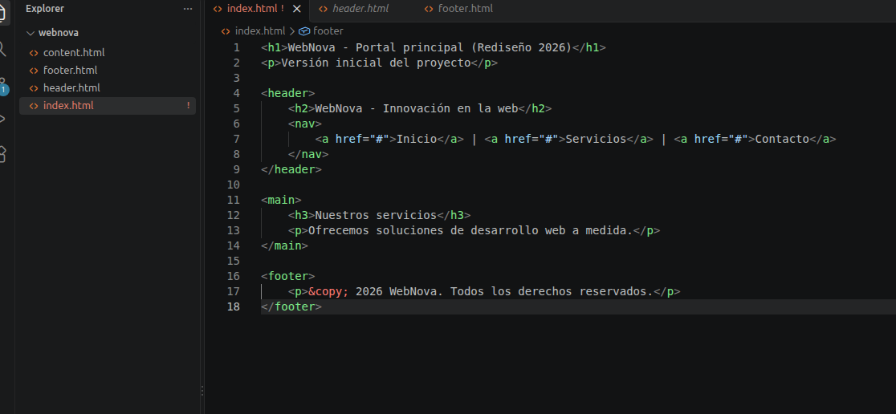

### 7. Terminar fusión
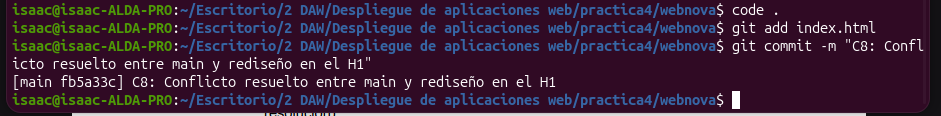

---

## Parte 4: Ver historial

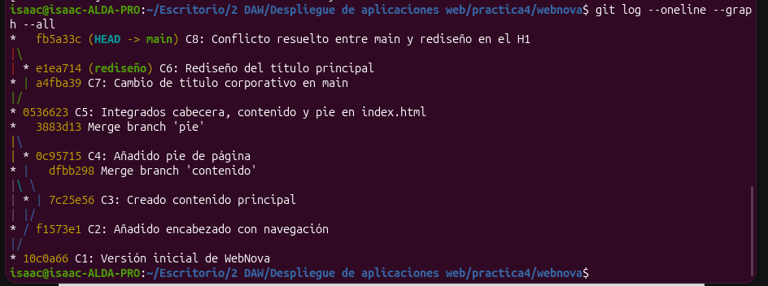

---

## Reflexión teórica

### ¿Por qué ocurrió el conflicto en la Parte 3 y no en la Parte 2?

En la Parte 3 hubo conflicto porque main y rediseño cambiaron la misma línea de index.html, el h1, partiendo del mismo punto. Al intentar fusionarlas, Git compara las dos versiones con la original y se encuentra con dos cambios distintos en el mismo sitio. Como no sabe cuál de los dos es el bueno, no fusiona y te deja unas marcas donde hay error.
En la Parte 2 no pasa porque con cada rama se ha creado un archivo diferente (header.html, content.html y footer.html). Al no tocar ninguna las mismas líneas, los cambios no se superponen entre sí y Git los puede juntar sin errores.

### Al ejecutar `git switch main` en la Parte 3.2, ¿qué ocurrió con los archivos del directorio de trabajo?

Al hacer git switch main, Git mueve HEAD para que apunte a main y cambia los archivos de la carpeta para que coincidan con el último commit de esa rama. Por eso, el index.html vuelve a tener el h1 de antes del rediseño, el c5. Ese cambio no se pierde, sigue guardado en el commit C6 de la rama rediseño, y reaparece si vuelvo a esa rama.
